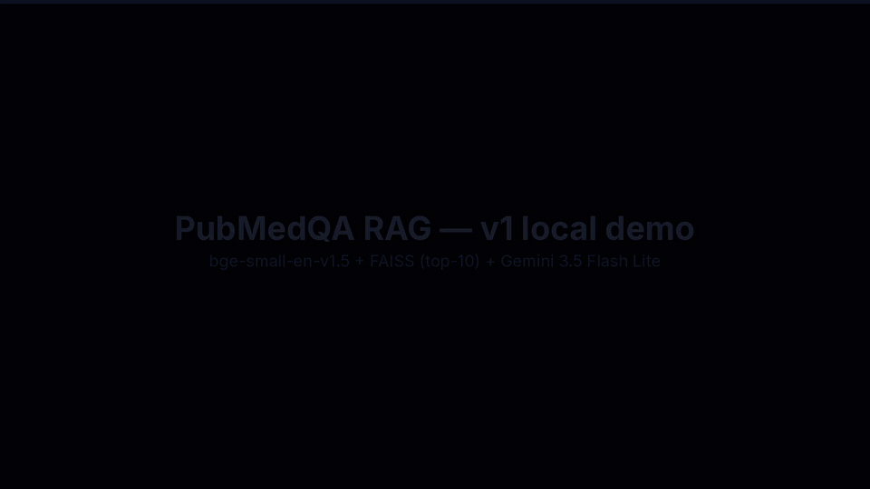
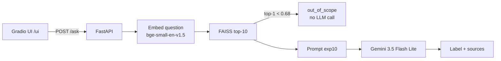

# pubmedqa-rag

Retrieval-augmented question answering over [PubMedQA](https://pubmedqa.github.io/) ([Jin et al., 2019](https://aclanthology.org/D19-1259/)): given a biomedical research question, retrieve PubMed abstract passages and answer **yes / no / maybe** with cited sources.

> Research demo only. **Not medical advice.**



## How v1 works



- **Corpus:** every `context.contexts` passage of the 1,000 `pqa_labeled` abstracts (3,358 chunks). The `long_answer` (the abstract's conclusion) is not indexed.
- **Embedding:** `BAAI/bge-small-en-v1.5`, CLS pooling, L2-normalized, no query prefix. Dataset and model revisions are pinned in `manifest.json`.
- **Index:** FAISS `IndexFlatIP` (exact cosine search).
- **Generation:** top-10 passages, prompt `src/rag/prompts/exp10.txt`, `gemini-3.5-flash-lite`. The model writes a short reasoning and ends with `Answer: yes|no|maybe`.
- **Out-of-scope gate:** if the best passage scores below 0.68, the API answers `out_of_scope` without calling Gemini.
- **Serving:** FastAPI (`POST /ask`, `GET /health`) with the Gradio UI mounted at `/ui`, one worker, shared rate limiter (15 requests / 60 s).

## Run locally (Windows PowerShell)

Requirements: Python 3.10, a Gemini API key. An NVIDIA GPU is optional (tested on a GTX 1650 4 GB); set `RAG_DEVICE=cpu` without one.

```powershell
python -m venv .venv
.\.venv\Scripts\Activate.ps1

# GPU: install torch from the CUDA 12.6 index first (skip for CPU)
python -m pip install torch==2.14.1 --index-url https://download.pytorch.org/whl/cu126
python -m pip install -e ".[dev,index,api,ui]"

# API key: copy the template and fill GEMINI_API_KEY (.env is gitignored)
Copy-Item .env.example .env

# Build the index once (no Gemini calls)
python scripts/build_index.py --out-dir artifacts/pubmedqa-bge-small-v1

# Start the server, then open http://127.0.0.1:8000/ui
python -m uvicorn rag.api:app --host 127.0.0.1 --port 8000 --workers 1
```

Optional environment variables: `RAG_DEVICE` (`cuda` by default), `RAG_DAILY_LIMIT` (cap on Gemini calls per day), `RAG_MAX_PENDING` (default 4).

Reproduce the numbers below:

```powershell
pytest -q                                                    # unit tests, no Gemini / FAISS calls
python scripts/eval_retrieval.py --artifact-dir artifacts/pubmedqa-bge-small-v1 --out-dir results/my-retrieval
python scripts/eval_e2e.py --out-dir results/my-e2e         # calls Gemini: 500 questions, about 500 requests
```

## Results (v1)

Splits of `pqa_labeled` (train order): rows 0–199 were used for development (prompt and `top_k` tuning), rows 200–699 are the held-out evaluation set, and rows 700–999 are kept untouched for a future test.

**Retrieval** (rows 0–199, dense, a hit means a passage from the gold abstract is retrieved), from `results/retrieval-pubmedqa-bge-small-v1/summary.json`:

| Metric | @5 | @10 |
|---|---|---|
| Recall | 0.985 | 0.990 |
| MRR | 0.968 | 0.969 |

BM25 on the same questions reached Recall@5 0.945 and hybrid (RRF) did not beat dense, so v1 uses dense only.

**End to end** (held-out rows 200–699, n = 500), from `results/e2e-heldout-exp10-k10/summary.json`:

| Metric | Value |
|---|---|
| Accuracy | **0.710** (95% Wilson CI 0.669–0.748) |
| Macro-F1 | 0.549 |
| Always-"yes" baseline | 0.570 |
| Parse failures / out-of-scope | 0 / 0 |

| Label | Precision | Recall | F1 | Support |
|---|---|---|---|---|
| yes | 0.852 | 0.807 | 0.829 | 285 |
| no | 0.735 | 0.680 | 0.706 | 175 |
| maybe | 0.088 | 0.150 | 0.111 | 40 |

Out-of-scope gate (`results/scope/`): on a held-out set of 200 in-domain questions, 30 paraphrases and 30 new off-topic questions, it blocked 0% of valid questions and 100% of off-topic ones.

## Known limitations of v1

1. **Retrieval is easy by construction.** The corpus contains the gold abstract of every question, and only 3,358 passages. Recall@5 0.985 says little about a real search over PubMed; the setting is close to PubMedQA's reasoning-required setup. A distractor-corpus experiment (adding `pqa_artificial` abstracts) is the first step of v2.
2. **"maybe" is mostly wrong.** F1 0.11: the model predicts maybe 68 times but only 6 are correct, and 34 of 40 gold-maybe questions get yes or no. Part of the cause is that the conclusion (`long_answer`) is not in the context, so the model has to infer the authors' verdict from the results.
3. **Vanilla RAG, no training.** Off-the-shelf embedding, no reranker, no fine-tuning; gains so far come from prompt rules only.
4. **Development set was reused for tuning.** Prompt and `top_k` were picked on rows 0–199; only the held-out numbers above should be quoted.
5. **Depends on a paid API with quotas.** Gemini free tier (15 requests / min, daily cap), so the demo runs locally rather than as a public deployment.

## Layout

- `src/rag/`: library (`core.py` pure helpers, `embedding.py`, `gemini.py` adapter and rate limiter, `engine.py` RAGEngine, `api.py` FastAPI + Gradio, `prompts/`)
- `scripts/`: index build and evaluation scripts
- `tests/`: pytest
- `notebooks/`: original Colab experiments
- `results/`: evaluation summaries
