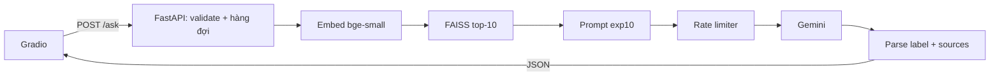
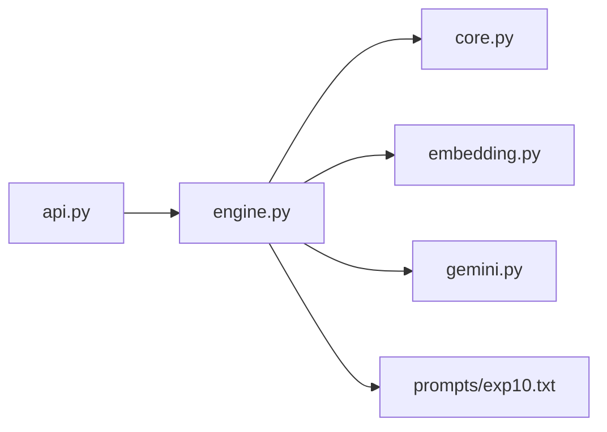

# pubmedqa-rag

Research demo: RAG over [PubMedQA](https://pubmedqa.github.io/) (Jin et al., 2019). **Not medical advice.**

## Setup

```bash
python -m venv .venv
# Windows: .venv\Scripts\activate
source .venv/bin/activate
pip install -e ".[dev]"
# or: pip install -r requirements.txt && pip install -e .
```

## Tests

```bash
pytest -q
```

Unit tests cover pure helpers in `src/rag/core.py` (tokenize, context formatting, label parse, RRF). No Gemini / FAISS calls.

## Layout

- `src/rag/` — library code
- `tests/` — pytest
- `notebooks/` — Colab / experiment notebooks
- `results/` — local experiment outputs (jsonl gitignored)

## Pipeline (locked)

Dense `bge-small` + FAISS **top-10** + Gemini Flash Lite + exp10 prompt. Hybrid RRF did not beat dense on this split.
Ví dụ đại ca gõ câu lace plant vào ô hỏi trên web Gradio rồi bấm Gửi. Từ lúc đó đến lúc ra đáp án, câu hỏi đi qua 9 bước:

1. **Gradio** (giao diện web) gửi request `POST /ask {"question": "..."}` tới server.
2. **FastAPI** (`api.py`) nhận request. Pydantic kiểm tra câu hỏi: rỗng hoặc quá dài thì trả lỗi `422` ngay, không tốn quota Gemini.
3. `Kiểm tra hàng đợi: nếu đã có quá nhiều câu đang chờ, server trả 503 và báo thử lại sau. Nếu chưa đầy thì câu hỏi được chuyển xuống engine.`
4. **Embed câu hỏi** (`engine.py`): model `bge-small` đã nằm sẵn trong RAM biến câu hỏi thành một vector 384 số, mất vài chục ms.
5. **FAISS tìm kiếm**: so vector đó với 3358 vector của các đoạn văn PubMed, lấy ra 10 đoạn giống nhất. Bước này mất vài ms.
6. **Ghép prompt**: luật exp10, cộng 10 đoạn bằng chứng, cộng câu hỏi.
7. **Rate limiter**: nếu chưa đủ khoảng cách 4,1s so với lần gọi Gemini trước, hoặc 60 giây vừa qua đã đủ 15 lần gọi, thì câu hỏi chờ đến lượt. Nếu dư quota thì đi luôn.
8. **Gemini** đọc bằng chứng và trả về một đoạn văn bản kết thúc bằng `Answer: yes`, mất khoảng 3 giây. Nếu quá 30 giây chưa có trả lời thì hủy và báo lỗi `504`.
9. **Parse kết quả**: lấy nhãn `yes`, gắn danh sách nguồn (pubid, đoạn văn), rồi FastAPI trả JSON về cho Gradio. Gradio hiển thị đáp án và nguồn cho đại ca.

Tổng thời gian khoảng 3 đến 4 giây, gần như toàn bộ là chờ Gemini; phần retrieval chưa tới 0,1 giây. Đây cũng là lý do model và index được load một lần lúc server khởi động: nếu mỗi câu hỏi phải load lại thì riêng bước đó đã mất hàng chục giây.



Bước 1 do Gradio làm, bước 2 và 3 do `api.py` làm, bước 4 đến 9 do engine làm (gọi Gemini qua `gemini.py`). Engine và Gemini đã có sẵn và test xong rồi; prompt FastAPI vừa rồi chỉ viết thêm lớp `api.py`.
Trong `src/rag/` có 5 file `.py`, cộng thêm file prompt `exp10.txt`. Mỗi file giữ một trách nhiệm, xếp từ trong lõi ra ngoài:

**1. `core.py`: các hàm thuần**
- **Mục đích:** gom các hàm xử lý chữ nhỏ, không phụ thuộc model, mạng hay file.
- **Gồm:**
  - `clean_and_tokenize` tách từ cho BM25.
  - `build_context` ghép 10 đoạn bằng chứng thành khối `[1] ... [2] ...`.
  - `parse_label` dùng regex `Answer:\s*(yes|no|maybe)` để lấy nhãn từ câu trả lời của Gemini, không khớp thì trả `parse_fail`.
  - `rrf_fuse` trộn kết quả dense và BM25, giữ lại từ thí nghiệm hybrid.
- **Vì sao tách riêng:** đây là chỗ dễ sai âm thầm nhất. Ví dụ regex parse lệch thì accuracy tụt mà không báo lỗi gì. Tách riêng thì test được rất nhanh, không cần GPU hay API key.

**2. `embedding.py`: biến chữ thành vector**
- **Mục đích:** một hàm `embed_texts()` duy nhất, dùng chung cho build index, eval và engine.
- **Phương pháp:**
  - `bge-small` qua `AutoModel`, lấy vector CLS (`last_hidden_state[:,0]`).
  - Chuẩn hóa L2 để tích vô hướng chính là cosine similarity.
  - Không thêm query prefix, chạy FP32, `eval()` + `inference_mode()`.
- **Vì sao tách riêng:** câu hỏi và đoạn văn **bắt buộc embed giống hệt nhau**. Chỉ cần lúc build dùng CLS mà lúc hỏi dùng mean pooling là vector lệch không gian, retrieval sai hết mà không có lỗi nào. Một hàm chung loại bỏ hẳn nguy cơ này.

**3. `gemini.py`: adapter gọi LLM**
- **Mục đích:** gói mọi chi tiết của SDK Google vào một chỗ.
- **Phương pháp:**
  - Đọc `GEMINI_API_KEY` từ environment, không bao giờ viết key vào code.
  - Timeout 30 giây, không retry.
  - `GeminiRateLimiter` dùng chung toàn process: các lần gọi cách nhau ít nhất 4,1 giây và không quá 15 lần trong 60 giây.
  - Mọi lỗi SDK được bọc thành `GeminiRequestError`, và sắp có thêm `kind` để phân biệt timeout, rate limit hay lỗi khác.
- **Vì sao tách riêng:** muốn đổi sang Claude hay GPT chỉ cần viết adapter mới, engine không phải sửa. Khi test thì thay bằng client giả, không tốn quota.

**4. `engine.py`: bộ não RAG**
- **Mục đích:** class `RAGEngine` nối tất cả thành pipeline.
- **Phương pháp:**
  - `load_resources()` chạy **một lần**: đọc `manifest.json`, `index.faiss`, `metadata.jsonl`, load model, rồi kiểm tra chúng khớp nhau (dimension, model revision, số vector).
  - `retrieve(q)` embed câu hỏi, lấy FAISS top-10, rồi tra metadata ra pubid và đoạn văn.
  - `answer(q)` chạy retrieve, ghép context, điền prompt exp10, gọi Gemini, parse nhãn và nguồn, rồi trả dict kèm thời gian từng bước.
- **Vì sao tách riêng:** engine không biết gì về HTTP. Gọi trực tiếp trong Python để chạy eval 200 câu được, mà bọc trong API cũng được.

**5. `api.py`: cửa ngõ HTTP**
- **Mục đích:** biến engine thành dịch vụ web để Gradio hoặc client khác gọi vào.
- **Phương pháp:**
  - FastAPI với lifespan để load engine một lần khi server bật.
  - Pydantic kiểm tra input và định dạng output.
  - Semaphore giới hạn số request đang chờ.
  - Đổi exception thành status code (`422`/`429`/`503`/`504`/`502`/`500`).
  - `/health` không tốn quota.
- **Vì sao tách riêng:** giao tiếp mạng là một nỗi lo khác hẳn logic RAG, trộn chung thì cả hai khó test.

**Phụ: `prompts/exp10.txt`**
Đây là file chữ chứa prompt exp10, có hai chỗ trống `{question}` và `{context}`. Để prompt riêng khỏi code thì sau này thêm exp11 chỉ cần tạo file mới, `prompt_id` trong kết quả cho biết đã dùng prompt nào.

**Ai phụ thuộc vào ai:**

Mũi tên chỉ đi một chiều từ ngoài vào trong: file trong lõi không import ngược file bên ngoài. Nhờ vậy, file càng ở trong càng ổn định và test càng dễ.

Ngoài `src/rag/` còn 2 script trong `scripts/`, cũng dùng `embedding.py`:
- `build_index.py` chạy một lần để tạo 3 file artifact.
- `eval_retrieval.py` đo Recall và MRR trên 200 câu.